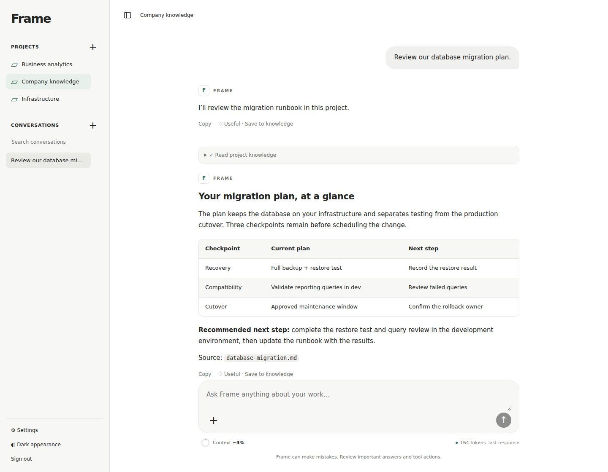
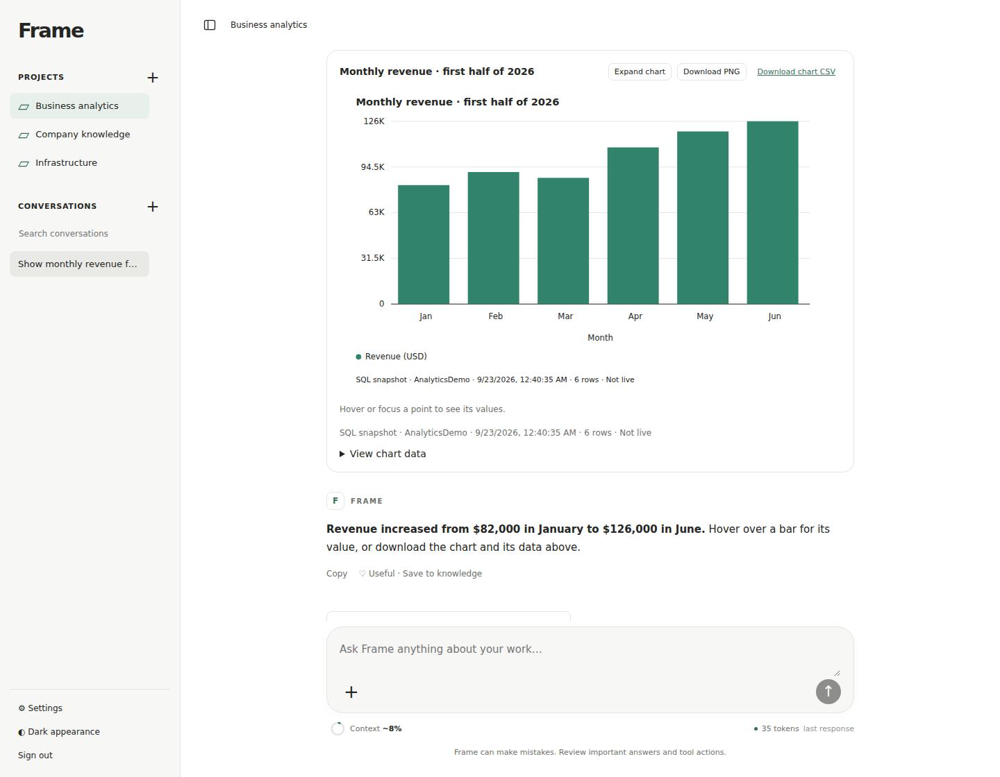

<div align="center">

# Frame

### Your knowledge. Your infrastructure.

A self-hosted AI workspace for company knowledge, SQL analysis, and local models.

[](https://github.com/hgursel/frame/actions/workflows/ci.yml)

[Features](#features) · [Quick start](#quick-start) · [Documentation](#documentation) · [Roadmap](docs/ROADMAP.md)

</div>

Bring your documents, project knowledge, and SQL data into one conversational workspace. Ask questions, investigate results, create charts, and turn useful answers into knowledge you can keep—using your chosen OpenAI-compatible model server.

Frame embeds the **Pi SDK**, so there is no separate Pi installation to manage. Configure your model, projects, and built-in plugins through the web interface.



_The running Frame interface with fictional demonstration content. [Screenshot details](docs/images/README.md)._

## Features

### Company knowledge that grows with your work

- **Bring your documents.** Upload Markdown, TXT, CSV, PDF, and DOCX files to the current conversation. They reach the model with your next message; explicitly choose **Add to project knowledge** to reuse a file elsewhere.
- **Keep useful answers.** Use **Useful → Save to knowledge** on answers and tool results. Review a new Markdown page or an update before saving it.
- **Maintain knowledge on your schedule.** Run nightly health checks and learn reusable procedures, calculation rules, and parameterized SQL templates from completed chats. Choose review-first or automatic publishing; SQL results never become learned knowledge.
- **Find the right page faster.** Descriptions, tags, and aliases help small local models retrieve focused knowledge without loading the entire wiki.
- **Remember useful methods.** Project memory learns recurring tasks and parameterized SQL without saving result values. Keep up to 30 methods per project, review changes, and supply relevant methods directly to future chats. [Configure learning and maintenance →](docs/KNOWLEDGE_MAINTENANCE.md)
- **Keep the history.** Knowledge pages include revisions and provenance. Export or import a portable **Open Knowledge Format 0.2** bundle with an index, change log, and Frame revision history. Preview imports; conflicting pages update with prior versions preserved.
- **Add shared business references.** Open **Settings → Knowledge Library → Browse packs** to search eight included packs and 28 detailed federal, industry, California, and guild guides. Inspect sections, install directly, or download JSON without leaving Frame. Topics include employment, safety, privacy, commercial practices, IP/AI, benefits, tax preparation, governance, entertainment, and work with outside counsel. Industry guides cover technology/services, healthcare, nonprofits, education, property, manufacturing, construction, logistics, and retail/hospitality. Attach a version to selected projects separately; open cited sections inside chat. No bargaining agreement content is included in the new guides. [Explore the Knowledge Library →](docs/KNOWLEDGE_LIBRARY.md)
- **Send internal email after review.** Configure SMTP once, find colleagues by their admin-managed profiles, and send generated outputs to approved internal domains. Interactive emails require a visible draft and explicit Send confirmation; activated schedules authorize unattended sends. [Configure email →](docs/EMAIL.md)
- **Organize by project.** Give each project its own instructions, conversations, files, knowledge, and plugin choices.

[Explore the knowledge workflow →](docs/KNOWLEDGE.md)

### Conversation workspace

- **Answer focused questions.** Frame can ask up to four questions with choices and custom answers, then continue from your response.
- **Find files in one place.** Open **Files** for conversation Sources and generated Outputs in a separate panel.
- **Schedule work from chat.** Review and activate one-time or recurring tasks, then manage them under **Scheduled** at the bottom left. Use the originating project's enabled skills and file/Python tools, run read-only SQL analyses, generate reports, and send approved internal emails while offline. Results stay in Scheduled. [Set up scheduled tasks →](docs/SCHEDULED.md)
- **Give longer tasks time.** Runs allow 60 minutes of execution, pausing the timer while waiting for question answers.

### Frame for Excel (Windows pilot)

Use Frame in an Excel Desktop task pane: start on a blank sheet, explain or repair formulas, clean data, import saved read-only SQL results, and work directly on existing worksheets. Selected cells are included automatically with each message. Frame can read other sheets as needed and preview changes to values, formulas, formatting, tables, charts, sorting, filters, and worksheet rows/columns. Project knowledge remains available. Every workbook batch has a preview and explicit **Apply** button, with changed-cell checks and no automatic replay.

Excel selections now default to **100,000 cells / 1,024 columns**, with configurable limits, context-budgeted section reads, and visible supplied-range details. Grouped thinking/tool activity, a fixed-bottom composer, and a separate paginated review panel keep long conversations usable. Large writes are batched with progress and retain the same explicit approval controls. The composer includes send/stop, conversation-only file/image attachments, screenshot paste, knowledge selection, and context/throughput controls. Applied changes stay with their original response; sending a follow-up replaces a pending proposal without applying it.

Install locally using an XML manifest from **Settings → Frame for Excel**. The Excel add-in uses your personal Frame account and requires trusted HTTPS and Microsoft 365 Excel with ExcelApi 1.16; Microsoft 365 Integrated Apps deployment is unnecessary. Automated tests use a simulated Office host; real Windows Excel and local-model acceptance remain required. [Installation, self-signed certificate, and pilot limits →](docs/FRAME_FOR_EXCEL.md)

### SQL analysis with explicit controls

The built-in **MSSQL plugin** lets you work with SQL Server through conversation:

- Ask questions against administrator-selected databases using SQL Authentication.
- Run supported reads through one shared read-only login. Writes, schema changes, and stored procedures are disabled for everyone.
- Initialize searchable schema knowledge so models can find table structures and relationships without rediscovering the database each time.
- Optionally generate per-object notes and business vocabulary, processing large catalogs one object at a time.
- Expand a query result to inspect its table and download returned rows as CSV, without filling the conversation with automatic export files.

Configure the shared connection in system settings, then enable MSSQL for individual projects. SQL Server permissions must also restrict the shared login to reads and permitted metadata.

[Set up MSSQL →](docs/MSSQL.md)

### Charts, right in the conversation

Ask for a **bar, line, pie/donut, or scatter chart** from SQL results, CSV files, or Markdown tables in chat and knowledge. Frame can filter, group, total, average, and sort the data locally. Hover for values, toggle legend entries, and expand the chart for PNG/CSV downloads.

Charts use saved datasets instead of asking the model to copy every value into its context. They remain available when you reopen the conversation, without rerunning queries. Partial-result warnings remain visible. File and chat charts work without enabling MSSQL.



_Fictional sample revenue shown in an earlier interface; the current card uses one expand icon and places downloads in the expanded view. Charts is enabled per project; the model is instructed to create charts only when you explicitly ask._

[Set up Charts →](docs/CHARTS.md)

### Reports in your organization’s style

Turn findings, conversation charts, and tables into **branded PDF reports**. Upload a logo, choose three colors, and describe required sections and writing style in Markdown. Start with executive, data analysis, or technical layouts, with centered logos, Title Case headings, cover and confidentiality pages, repeating table headers, and page numbers.

Set organization defaults and optional project overrides. Ask for a report directly in chat, then request revisions as new PDFs. Rendering runs locally through the optional document runtime and does not require trusted host tools or MSSQL.

[Set up Reports →](docs/REPORTS.md)

### Your own skills

Point Frame at folders of **Agent Skills**—the `SKILL.md` format used by OpenCode, Claude Code, and Pi—and enable them per project. The model sees each skill's name and description, reads the full instructions when a task matches, and runs its Bash or Python scripts with the project's isolated file and Python tools. Type `/` in the message box to pick a skill directly. Only administrators can install, see, select, or use skills. Regular users cannot access skill APIs or invoke skills; configured skill folders are hidden from their file tools. Do not store credentials in skill directories.

[Use your skills →](docs/SKILLS.md)

### A familiar workspace for local models

| Capability           | What you can do                                                                                                   |
| -------------------- | ----------------------------------------------------------------------------------------------------------------- |
| Streaming chat       | Follow activity between intermediate replies; expand reasoning, tools, and SQL results. Only the current step animates.                                          |
| Rich answers         | Read Markdown tables, code blocks, and locally rendered Mermaid diagrams.                                         |
| Context visibility   | See context usage and observed tokens/second; use automatic compaction or create a manual checkpoint.             |
| Document generation  | Generate all PDFs with Reports; Word/DOCX generation remains available through trusted document tools. |
| Conversation control | Resume saved chats, use incognito chats excluded from history and learning, stop active tasks, and remove conversations or entire projects with confirmation.             |
| Everyday interface   | Use light/dark appearance, conversation search, attachments, and mobile navigation.                               |

## Try asking Frame

| Start with            | Ask                                                                                   |
| --------------------- | ------------------------------------------------------------------------------------- |
| Project documents     | “Review our migration plan and identify the remaining checks. Cite the source files.” |
| SQL Server            | “Which products had the highest revenue last quarter? Show the query results.”        |
| Saved SQL results     | “Turn those results into a bar chart.”                                                |
| Findings and charts   | “Create a branded PDF report with these findings, the chart, and recommendations.”     |
| A useful conversation | “Draft a knowledge page explaining what we learned so I can review and save it.”      |

SQL examples require the MSSQL plugin and an appropriate schema. Model-driven tools require a compatible model and chat template.

## Quick start

**Requirements:** Linux (Ubuntu 26.04 recommended), Node.js 24 LTS, npm, and an OpenAI-compatible model endpoint. File/Python tools additionally require `bubblewrap`, Python 3, and permitted unprivileged user namespaces. Frame does not install or configure your model engine.

```bash
git clone https://github.com/hgursel/frame.git
cd frame
npm ci
npm run build
npm start
```

1. Open **http://127.0.0.1:3000**. Use the setup token printed in the server console to create an administrator username and password.
2. Go to **Settings → Model**. Enter your OpenAI-compatible base URL, such as `http://127.0.0.1:8080/v1`, and the model alias it serves. Save and test the connection.
3. In **Settings → Context**, match the context window to the model server’s per-request capacity and reserve room for output.
4. Every new account starts with a private **Arena** project. Add documents under **Knowledge**, create additional projects, and start a conversation.
5. Configure Reports, Charts, or MSSQL in **Settings → Plugins**, then enable them in **Project settings → Plugins**. Admin-only skills have their own **Skills** category. For MSSQL, initialize database knowledge.

The endpoint is reached from the Frame server. Administrators can configure HTTP(S) addresses, DNS names, and custom API base paths. There is no provider fallback. Configure simultaneous model requests and image/tool support in **Settings → Context**. For PDF/DOCX generation, install the optional document runtime from **Settings → Documents**; Ubuntu also needs Python 3 and `python3-venv`.

For access from another computer, follow the [LAN, HTTPS reverse-proxy, or SSH-tunnel guide](docs/DEPLOYMENT.md). Deployment-level network and storage settings are configured outside the browser.

### Image conversations

Use **+ → Upload images**, or paste a screenshot into the chat. Preview or remove images before sending; an image can also be sent without text. PNG, JPEG, and WebP are supported (four per message, 10 MiB per source image). Frame resizes images to a maximum 2048-pixel edge and sends them directly to your local vision model. Images stay in the conversation, not project knowledge; incognito images are temporary. Enable image input only when the configured server and model support it.

## Local by design

- **Your model endpoint.** Frame connects only to the OpenAI-compatible endpoint your administrator chooses, with no automatic fallback.
- **Your stored data.** Project files, knowledge, settings, chart datasets, and conversation history stay in the configured data directory on the Frame host.
- **No telemetry.** Frame disables Pi install telemetry and model-catalog network refreshes. Initial dependency installation still requires package downloads.
- **Optional reference downloads.** Browsing knowledge packs works offline. Explicitly downloading or installing an optional pack contacts Frame’s public GitHub repository, verifies its checksum, and sends no project content. Installed packs remain local; project attachment and upgrades are separate choices.
- **Project capabilities.** File and Python tools are always enabled in ordinary project chats and remain isolated. Frame for Excel starts disabled for new projects; owners enable it in Project settings → Plugins. Existing Excel selections are preserved.

> [!IMPORTANT]
> **Personal workspaces:** admins create local accounts and configure shared connections; users own private projects and knowledge. Admin accounts cannot browse other owners’ content through Frame. Server operators still control the underlying files. File/Python tools fail closed if Linux isolation is unavailable. See [multiuser setup and migration](docs/MULTIUSER.md).

## Documentation

| Guide                                  | Covers                                                                          |
| -------------------------------------- | ------------------------------------------------------------------------------- |
| [Knowledge](docs/KNOWLEDGE.md)         | Uploads, reviewed updates, Markdown pages, OKF import/export, and Python documents     |
| [Knowledge maintenance](docs/KNOWLEDGE_MAINTENANCE.md) | Scheduling, publishing policies, health checks, SQL privacy, and incognito chats |
| [MSSQL](docs/MSSQL.md)                 | Connection setup, read-only SQL permissions, and schema knowledge              |
| [Reports](docs/REPORTS.md)             | Branded PDF layouts, project overrides, chart/table sources, and local rendering |
| [Skills](docs/SKILLS.md)               | Agent Skills folders, project enablement, `/skill` commands, and credentials    |
| [Charts](docs/CHARTS.md)               | Chart types, dataset limits, exports, and saved snapshots                       |
| [Context management](docs/CONTEXT.md)  | Token budgets, compaction, checkpoints, and measurement limits                  |
| [Deployment](docs/DEPLOYMENT.md)       | Ubuntu service setup, private access, updates, and backups                      |
| [Runtime and data](docs/OPERATIONS.md) | Model compatibility, storage layout, credentials, tool boundaries, and deletion |
| [Development](docs/DEVELOPMENT.md)     | Local development, automated checks, browser tests, and references              |
| [Architecture](docs/ARCHITECTURE.md)   | Application structure and Pi SDK integration                                    |
| [Roadmap](docs/ROADMAP.md)             | Implemented features, planned work, and acceptance checks                       |

## Project status and contributing

Frame supports local multiuser accounts, personal projects, and concurrent conversations. Project sharing, online skill installation, and a packaged installer remain future work. Automated tests cover ownership, migration, streaming through the real Pi SDK with mock OpenAI-compatible endpoints, queuing, cancellation, and reconnects. Validate your actual model engine, Linux isolation, SQL permissions, and Excel installation before rollout.

Have a bug or an idea? [Open an issue](https://github.com/hgursel/frame/issues). For code changes, read [AGENTS.md](AGENTS.md) and the [development guide](docs/DEVELOPMENT.md). Keep reports free of credentials and private organization data.

## Built with

[Pi SDK](https://pi.dev/docs/latest/sdk) · OpenAI-compatible model APIs · React · TypeScript · Fastify · SQLite

The knowledge workflow draws on [Google's Open Knowledge Format](https://github.com/GoogleCloudPlatform/open-knowledge-format/blob/main/SPEC.md) and [Karpathy's LLM Wiki pattern](https://gist.github.com/karpathy/442a6bf555914893e9891c11519de94f).

## License

A source license for Frame has not been selected yet. Dependency licenses remain applicable.
